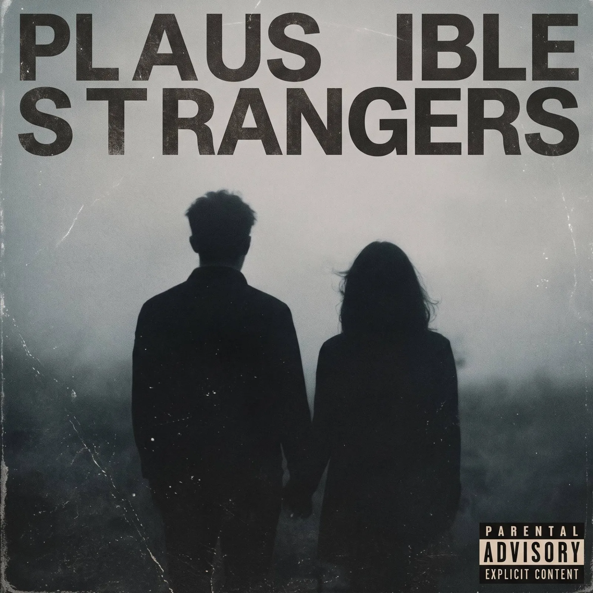

  

<h1 align="center">plausible strangers.</h1>

  <em>Electronic music to dance to, drift off to, and play a little too loud.</em> 
  <a href="https://plausiblestrangers.com">plausiblestrangers.com</a> ·
  <a href="https://suno.com/@plausiblestrangers">suno</a> ·
  <a href="https://x.com/plstrangers">x / twitter</a> ·
  <a href="https://github.com/burningtree/plausiblestrangers">github</a>

---

Plausible Strangers is a human-directed, machine-made electronic music project. Hypnotic grooves somewhere between
house, techno and electroclash, with strange voices, misplaced instruments and occasionally just noise.

We have loved music all our lives but never had the lessons, the instruments or the hands to play them. So a machine
plays what we can't, and we do the rest: the ideas, the words, and a lot of listening. Most of what it makes, we throw
away; we keep only the songs we'd put on ourselves. Nothing is hidden: every song's lyrics and the prompt behind it
are on the website.

Inspired by Vitalic, Sexy Sushi, Fischerspooner, The Blaze, МЫ, MIDI Lidi, Forest Swords and
[many more](https://plausiblestrangers.com/about/#influences).

**All our music is free:** public domain under [CC0](https://creativecommons.org/publicdomain/zero/1.0/). Use it
however you like, no need to ask or credit us. (Our remixes of other artists' songs excepted.)

---

This repository is the website: a small static [Astro](https://astro.build) site, `npm install` then
`npm run dev`. How to add records and songs: [docs/website.md](docs/website.md).
